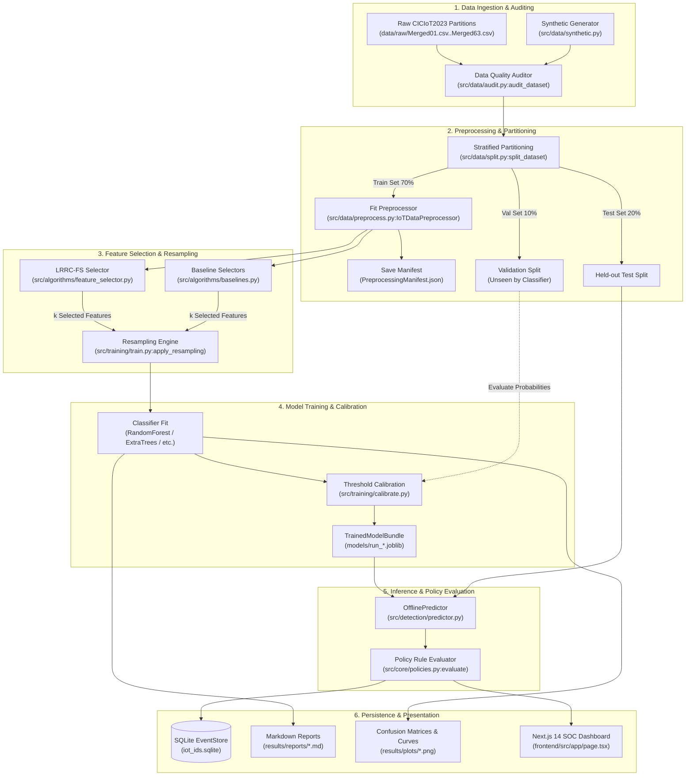

# DEVRAKSHAK // IoT Intrusion Detection System — Technical Onboarding Guide

> **Target Audience:** Newly onboarded Machine Learning & MLOps Engineers  
> **System Name:** DEVRAKSHAK (AI-Based IoT Intrusion & DDoS Defense System)  
> **Evaluated Dataset:** Official University of New Brunswick **CICIoT2023** (46 network traffic flow features, 34 raw attack types mapped to 8 canonical threat classes)  
> **Repository Root:** `d:\MINIPROJECT_AIML\IDS` (Core Subsystem) / `d:\MINIPROJECT_AIML` (Project Workspace)

---

## 1. High-Level Architecture & End-to-End Workflow

### 1.1 Product & Engineering Overview
From a product perspective, **DEVRAKSHAK** operates as an offline Security Operations Center (SOC) telemetry and analytics platform designed to detect distributed denial-of-service (DDoS), botnet (Mirai), injection, and reconnaissance attacks targeting IoT infrastructure. 

From an engineering perspective, the system is a modular tabular machine learning pipeline paired with:
1. An empirical feature selection engine (**LRRC-FS**: Lightweight Relevance-Redundancy-Cost Feature Selection).
2. Supervised ensemble classifiers (Random Forest, Decision Trees, Extra Trees, HistGradientBoosting) supporting **Binary** (`BENIGN` vs. `ATTACK`) and **Multiclass** (8 canonical threat classes) objectives.
3. A validation-driven **Threshold Calibration** module that sweeps decision thresholds to satisfy strict False Positive Rate (FPR) operational targets (e.g., 1%, 5%, 10%) on high-volume network streams.
4. An offline inference engine (`OfflinePredictor`) that maps predictions to policy rules (`POL-001` to `POL-007`) and generates severity-graded alerts.
5. A dual-interface serving layer consisting of a Python `http.server`-based REST API (Port `8000`) and a reactive **Next.js 14** SOC dashboard (Port `3000`).

---

### 1.2 End-to-End System Lifecycle Flowchart



---

### 1.3 Primary Entry Points & Execution Triggers

| Trigger Mechanism | Entry Point / File Path | Key Function / Class | Description |
| :--- | :--- | :--- | :--- |
| **CLI Master Entry** | `src/main.py` & `src/cli.py` | `src.cli.main()` | Dispatches commands: `synthetic`, `discover`, `audit`, `train`, `compare-selectors`, `compare-imbalance`, `predict`, `runs`, `events`, `policy`. |
| **Fullstack Launcher** | `start_fullstack.bat` | Windows batch wrapper | Spawns Python API (`http://127.0.0.1:8000`) and Next.js dev server (`http://localhost:3000`). |
| **Web Server CLI** | `src/web/server.py` | `src.web.server.run_web_server()` | Starts the multi-threaded HTTP REST server on host `127.0.0.1` and port `8000`. |
| **Dataset Pool Pipeline** | `src/data/build_dataset.py` | `build_dataset_pipeline()` | CLI script streaming 63 CSV partitions into balanced train/val pools and held-out test splits. |
| **Multi-Seed Experiments** | `src/training/run_experiments.py` | `run_experiments_pipeline()` | CLI harness running 5-seed benchmark evaluations with exact binomial confidence intervals. |
| **Feature Curve Sweep** | `src/training/feature_curve.py` | `run_feature_curve()` | Evaluates Macro F1 vs. feature count $k \in [5, 39]$ across competing selectors. |
| **Threshold Diagnostic** | `scripts/diag_threshold.py` | `main()` | Standalone diagnostic sweeping inference thresholds on test sets to verify FPR calibration. |
| **Workflow Orchestrators** | *None* | `[Needs Clarification]` | **No Airflow, Prefect, Celery, or Docker orchestrators** are configured in this repository. All execution is currently triggered via CLI, batch scripts, or direct REST calls. |

---

## 2. Models & ML Stack Inventory

### 2.1 Model Registry & Architectures
All models are classical tabular estimators provided by `scikit-learn` and `imbalanced-learn`. There are **no deep learning models (PyTorch/TensorFlow)**, **no external LLM API calls (OpenAI/Anthropic/Gemini)**, and **no remote weight repositories (Hugging Face/S3)**. Everything is fitted locally and serialized to disk.

```
+---------------------------------------------------------------------------------------------------------+
|                                    TRAINED MODEL BUNDLE ARCHITECTURE                                    |
|                                                                                                         |
|   +--------------------------+     +--------------------------+     +-------------------------------+   |
|   |   IoTDataPreprocessor    | --> |    BaseFeatureSelector   | --> |         BaseEstimator         |   |
|   | (Clean, Impute, Scale)   |     | (LRRC-FS, KBest, All)    |     | (Random Forest, Extra Trees)  |   |
|   +--------------------------+     +--------------------------+     +-------------------------------+   |
|                 |                                |                                  |                   |
|                 +--------------------------------+----------------------------------+                   |
|                                                  |                                                      |
|                                       joblib.dump(..., compress=3)                                      |
|                                                  v                                                      |
|                                     models/{run_id}.joblib                                              |
+---------------------------------------------------------------------------------------------------------+
```

| Model / Estimator | Definition Location | Instantiation Function | Supported Task | Key Hyperparameters & Config | Artifact Storage |
| :--- | :--- | :--- | :--- | :--- | :--- |
| **Random Forest** | `src/training/train.py` | `get_classifier("random_forest")` | Binary & Multiclass | `n_estimators=100`, `max_depth=None`, `random_state=42`, `class_weight='balanced'` (optional). | `models/{run_id}.joblib` |
| **Decision Tree** | `src/training/train.py` | `get_classifier("decision_tree")` | Binary & Multiclass | `criterion="gini"`, `max_depth=None`, `random_state=42`, `class_weight='balanced'` (optional). | `models/{run_id}.joblib` |
| **Extra Trees** | `src/training/train.py` | `get_classifier("extra_trees")` | Binary & Multiclass | `n_estimators=100`, `max_depth=None`, `random_state=42`, `class_weight='balanced'` (optional). | `models/{run_id}.joblib` |
| **HistGradientBoosting** | `src/training/train.py` | `get_classifier("gradient_boosting")` | Binary & Multiclass | `max_iter=100`, `random_state=42`, `class_weight='balanced'` (optional). | `models/{run_id}.joblib` |
| **LRRC-FS Selector** | `src/algorithms/feature_selector.py` | `LRRCSFeatureSelector` | Feature Selection | `n_features_to_select=15`, `w_rel=0.5`, `w_red=0.3`, `w_cost=0.2`, `relevance_metric="f_classif"`. | Embedded in bundle |
| **SelectKBest** | `src/algorithms/baselines.py` | `EstablishedKBestSelector` | Feature Selection | `k=15`, score function: ANOVA `f_classif`. | Embedded in bundle |
| **VarianceThreshold** | `src/algorithms/baselines.py` | `VarianceThresholdSelector` | Feature Selection | `threshold=0.01` (prunes constant/near-constant columns). | Embedded in bundle |
| **SMOTE** | `src/training/train.py` | `apply_resampling(strategy="smote")` | Class Imbalance | `k_neighbors=min(5, min_class_count - 1)`, applied strictly to training partition. | In-memory during train |
| **RandomUnderSampler**| `src/training/train.py` | `apply_resampling(strategy="undersample")` | Class Imbalance | `sampling_strategy="auto"`, applied strictly to training partition. | In-memory during train |

---

### 2.2 Mathematical Formulation of LRRC-FS
Defined in `src/algorithms/feature_selector.py:LRRCSFeatureSelector`. Selects subset $\mathcal{S}$ greedily:
$$\text{Score}(f, \mathcal{S}) = w_{\text{rel}} \cdot R_{\text{norm}}(f) - w_{\text{red}} \cdot D(f, \mathcal{S}) - w_{\text{cost}} \cdot C_{\text{norm}}(f)$$
- **$R_{\text{norm}}(f)$:** ANOVA F-statistic normalized to $[0, 1]$ via min-max scaling across candidates.
- **$D(f, \mathcal{S})$:** Mean absolute Pearson correlation between candidate $f$ and already selected features:
  $$D(f, \mathcal{S}) = \frac{1}{|\mathcal{S}|} \sum_{s \in \mathcal{S}} |\rho(f, s)|$$
- **$C_{\text{norm}}(f)$:** Static domain extraction cost lookups (e.g., protocol flags $= 0.2$, header fields $= 0.4$, rate metrics $= 0.8$, dispersion metrics $= 0.9$).

---

### 2.3 Threshold Calibration Engine
Defined in `src/training/calibrate.py:calibrate_decision_threshold`.  
- **Operating Problem:** In the uncalibrated model, threshold $0.50$ produces high False Positive Rates ($\sim 45\%$) on natural IoT traffic due to extreme class imbalance (97.4% attacks).
- **Mechanism:** Evaluates model probabilities strictly on a held-out **validation split** (10% of training data, unseen by the classifier). Sweeps thresholds $\theta \in [0.30, 0.95]$ in increments of $0.05$.
- **Target Selection:** Identifies thresholds achieving target FPR operating points ($1\%$, $5\%$, $10\%$) while maximizing Attack Recall:
  $$\text{FPR}(\theta) = \frac{\text{FP}(\theta)}{\text{FP}(\theta) + \text{TN}(\theta)}, \quad \text{Recall}(\theta) = \frac{\text{TP}(\theta)}{\text{TP}(\theta) + \text{FN}(\theta)}$$
- **Bundle Integration:** Stored directly inside `TrainedModelBundle.metadata["calibration"]` and `TrainedModelBundle.metadata["calibrated_threshold"]`.

---

## 3. Inputs & Outputs (Data Contracts)

### 3.1 System Inputs

#### 1. Raw Tabular Network Traffic (CSV)
- **Path:** `data/raw/Merged01.csv` through `data/raw/Merged63.csv` (or synthetic CSV in `data/synthetic/`).
- **Features:** 46 numerical flow features specified in `src/data/taxonomy.py:CICIOT2023_FEATURE_NAMES` (e.g., `flow_duration`, `Header_Length`, `Rate`, `syn_count`, `ack_count`, `Tot sum`, `IAT`, etc.).
- **Target Label Column:** One of `label`, `Label`, `LABEL`, `class`, `Class`, or `attack_type`.

#### 2. Configuration Files & Environment Variables
- **Config JSON (`config/settings.json`):**
  ```json
  {
    "data_dir": "data\\raw",
    "synthetic_dir": "data\\synthetic",
    "processed_dir": "data\\processed",
    "model_dir": "models",
    "results_dir": "results",
    "db_path": "iot_ids.sqlite",
    "sample_limit": 20000,
    "chunk_size": 50000,
    "random_seed": 42,
    "test_size": 0.2,
    "validation_size": 0.1,
    "lrrc_max_features": 15,
    "default_task": "binary",
    "default_model": "random_forest"
  }
  ```
- **Policy Definition (`config/policies.json`):**
  ```json
  {
    "policies": [
      {
        "policy_id": "POL-001",
        "name": "Critical Mirai Botnet Activity",
        "enabled": true,
        "attack_category": "Mirai",
        "min_confidence": 0.75,
        "severity": "CRITICAL"
      }
    ]
  }
  ```
- **Environment Prefix:** `IOT_IDS_*` (managed via `pydantic_settings.BaseSettings` in `src/core/settings.py:AppSettings`).

#### 3. API Request Payloads (`src/web/server.py`)
- **Inference (`POST /api/test`):**
  ```json
  {
    "file_path": "data/raw/Merged52.csv",
    "model_path": "models/run_binary_random_forest.joblib",
    "sample_limit": 65724,
    "threshold": 0.70,
    "record_events": true
  }
  ```
- **Asynchronous Training (`POST /api/train`):**
  ```json
  {
    "dataset_path": "data/raw/Merged01.csv",
    "model_name": "random_forest",
    "task_type": "binary",
    "feature_selector": "lrrc",
    "n_features": 15,
    "sample_limit": 20000,
    "async": true
  }
  ```
- **Local File Upload (`POST /api/upload`):**
  ```json
  {
    "filename": "custom_traffic.csv",
    "content": "<raw_csv_text_payload>"
  }
  ```

---

### 3.2 Intermediate Pipeline Artifacts

| Intermediate File | Generating Script / Method | File Format | Contents / Schema |
| :--- | :--- | :--- | :--- |
| **`data/processed/train_pool.csv`** | `src/data/build_dataset.py` | CSV / Parquet | Class-balanced training pool (deduplicated, 6,000 samples per class). |
| **`data/processed/val_pool.csv`** | `src/data/build_dataset.py` | CSV / Parquet | Validation pool for threshold calibration and hyperparameter validation. |
| **`data/processed/test_pool.csv`** | `src/data/build_dataset.py` | CSV / Parquet | Natural attack distribution held-out test set (100,000 flows from `Merged54`–`63`). |
| **`dataset_build_summary.json`** | `src/data/build_dataset.py` | JSON | Counts, seed, class distributions, and source file partition list. |
| **`models/{run_id}.joblib`** | `src/training/train.py:TrainedModelBundle.save` | Joblib (Zlib-3) | Dictionary containing fitted preprocessor, selector, classifier, classes, and calibration. |
| **`results/metrics/metrics_{run_id}.json`** | `src/training/evaluate.py:save_metrics_json` | JSON | Accuracy, macro F1, weighted F1, per-class metrics, confusion matrix counts. |
| **`results/plots/confusion_matrix_{run_id}.png`** | `src/training/evaluate.py:plot_and_save_confusion_matrix` | PNG Image | Matplotlib-rendered heatmap of the test split confusion matrix. |

---

### 3.3 Final System Outputs

#### 1. Generated Markdown Reports (`.md`)
The system programmatically authors three structured Markdown reports into `results/reports/`:
- **`audit_report_{ts_str}.md` (`src/data/audit.py:save_audit_report`):**
  Contains total rows, file count, null/infinite values, memory footprint, and target class distributions.
- **`feature_selection_comparison_{ts_str}.md` (`src/training/experiments.py:run_feature_selection_comparison`):**
  Markdown table comparing LRRC-FS, SelectKBest, VarianceThreshold, and All Features on Accuracy, Macro F1, Train Time, and Inference Latency.
- **`class_imbalance_comparison_{ts_str}.md` (`src/training/experiments.py:run_class_imbalance_comparison`):**
  Markdown table benchmarking Plain, Class Weighted, Random Under-Sampling, and SMOTE on recall and FPR.

#### 2. SQLite Database Writes (`iot_ids.sqlite`)
Managed via `src/detection/event_store.py:EventStore`:
- **Table `training_runs`:**
  `run_id` (PK), `timestamp`, `model_name`, `task_type`, `feature_selector`, `accuracy`, `macro_f1`, `weighted_f1`, `false_positive_rate`, `inference_latency_ms_per_sample`, `model_path`, `metrics_file`, `confusion_matrix_plot`.
- **Table `detection_events`:**
  `id` (UUID PK), `timestamp`, `source_file`, `row_index`, `predicted_label`, `confidence`, `is_attack`, `attack_category`, `severity`, `policy_triggered`, `raw_features` (JSON string of top flow features).

#### 3. Prediction CSV Export
- Triggered by client-side button `Download Predictions CSV` or CLI `cmd_predict`.
- Schema: `Flow_Index`, `Predicted_Category`, `Classification`, `Confidence`, `Severity`, `Ground_Truth`.

---

## 4. Directory & File Map

```
D:\MINIPROJECT_AIML\IDS
├── config/
│   ├── policies.json                 # Security alert policies (POL-001..007) and severity mappings
│   └── settings.json                 # Global pipeline hyperparameters, paths, and resource limits
├── data/
│   ├── processed/                    # Preprocessed train/val/test data pools and summary metadata
│   ├── raw/                          # 63 Merged*.csv official CICIoT2023 partitions (~9.4 GB total)
│   └── synthetic/                    # Generated test datasets for automated CI testing
├── docs/                             # Architectural reports, specifications, and UI reference assets
├── frontend/                         # Next.js 14 SOC Dashboard
│   ├── src/app/globals.css           # Tailwind CSS tokens (Dark obsidian/emerald theme)
│   ├── src/app/page.tsx              # Main dashboard: KPIs, Donut/Bar charts, Flow Inspector, ML Lab
│   └── package.json                  # Next.js 14, React 18, Recharts, Lucide dependencies
├── models/                           # Persisted .joblib model bundles (auto-pruned to newest 10)
├── results/
│   ├── metrics/                      # Serialized evaluation metrics (metrics_run_*.json)
│   ├── plots/                        # Confusion matrix heatmaps (confusion_matrix_run_*.png)
│   └── reports/                      # Auto-generated Markdown comparison and audit reports
├── scripts/
│   └── diag_threshold.py             # Diagnostic utility evaluating threshold vs. FPR trade-offs
├── src/
│   ├── __init__.py
│   ├── cli.py                        # Rich CLI implementation with 10 subcommands
│   ├── main.py                       # Top-level executable entry point routing to src.cli.main()
│   ├── algorithms/
│   │   ├── baselines.py              # SelectKBest, VarianceThreshold, and AllFeatures selectors
│   │   └── feature_selector.py       # LRRC-FS 4-term novel feature selector implementation
│   ├── core/
│   │   ├── engine.py                 # IDSEngine orchestrating data discovery, audits, training, and inference
│   │   ├── events.py                 # Pydantic v2 data models: DetectionEvent, TrainingRun, DatasetAuditResult
│   │   ├── logging_config.py         # Rotating file and colored console logger setup
│   │   ├── policies.py               # PolicyList and policy evaluation engine
│   │   └── settings.py               # AppSettings model with environment variable overrides
│   ├── data/
│   │   ├── audit.py                  # Schema inspection, missing value check, and Markdown report generator
│   │   ├── build_dataset.py          # Balanced train pool builder streaming across 63 partitions
│   │   ├── loader.py                 # Streaming chunked CSV loader with zip auto-unpacking
│   │   ├── preprocess.py             # IoTDataPreprocessor (median imputation, scaling, manifest generator)
│   │   ├── split.py                  # Stratified train/val/test splitter
│   │   ├── synthetic.py              # Synthetic CICIoT2023 data generator with realistic feature ranges
│   │   └── taxonomy.py               # 46 feature names, 34 raw attack mappings -> 8 canonical classes
│   ├── detection/
│   │   ├── event_store.py            # SQLite schema management and summary aggregation queries
│   │   └── predictor.py              # OfflinePredictor batch/stream classification and policy alerting
│   ├── training/
│   │   ├── calibrate.py              # Decision threshold sweep and FPR calibration engine
│   │   ├── evaluate.py               # Metrics computation, confusion matrix plotting, and JSON export
│   │   ├── experiments.py            # Comparative experiment runners generating Markdown reports
│   │   ├── feature_curve.py          # Feature count (k) evaluation curve generation
│   │   ├── run_experiments.py        # Multi-seed empirical benchmarking harness
│   │   ├── stats_utils.py            # Exact binomial Clopper-Pearson 95% confidence intervals
│   │   └── train.py                  # End-to-end training pipeline, bundle packaging, and pruning
│   └── web/
│       ├── server.py                 # Multi-threaded HTTP REST API server on port 8000
│       └── static/                   # Pure HTML/JS/CSS embedded fallback console
├── tests/                            # 52 automated pytest test cases covering all modules
├── iot_ids.log                       # Active rotating application log file
├── iot_ids.sqlite                    # Active SQLite database storing runs and events
├── requirements.txt                  # Python dependencies (scikit-learn, imbalanced-learn, textual, etc.)
├── start_fullstack.bat               # Windows batch launcher starting backend (8000) and frontend (3000)
└── start_web.bat                     # Full-stack startup script variant
```

---

## 5. Local Setup, Execution & Gotchas

### 5.1 Environment Setup

#### Python Environment
```bash
# Navigate to the core project directory
cd D:\MINIPROJECT_AIML\IDS

# Create and activate virtual environment (Python 3.11 - 3.13 supported)
python -m venv .venv
.\.venv\Scripts\activate

# Install dependencies
pip install -r requirements.txt
```

#### Frontend Environment (Next.js 14)
```bash
cd D:\MINIPROJECT_AIML\IDS\frontend
npm install
```

---

### 5.2 Common Execution Commands

#### 1. Launching Full Application
- **Windows (Single Click):** Double-click `start_fullstack.bat` in `D:\MINIPROJECT_AIML\IDS`.
- **Manual Launch:**
  ```bash
  # Terminal 1 (Python REST Server)
  cd D:\MINIPROJECT_AIML\IDS
  .\.venv\Scripts\python.exe -m src.web.server --host 127.0.0.1 --port 8000

  # Terminal 2 (Next.js Dashboard)
  cd D:\MINIPROJECT_AIML\IDS\frontend
  npm run dev
  ```

#### 2. Running Training via CLI
```bash
# Train Random Forest with LRRC-FS (15 features, binary task)
python src/main.py train --dataset data/raw/Merged01.csv --model random_forest --task binary --selector lrrc --features 15 --sample-limit 20000

# Train with class-imbalance handling (SMOTE)
python src/main.py train --dataset data/raw/Merged01.csv --model random_forest --resampling smote
```

#### 3. Running Comparative Experiments
```bash
# Feature selection algorithm benchmark (generates results/reports/feature_selection_comparison_*.md)
python src/main.py compare-selectors --dataset data/raw/Merged01.csv --features 15

# Class imbalance benchmark (generates results/reports/class_imbalance_comparison_*.md)
python src/main.py compare-imbalance --dataset data/raw/Merged01.csv
```

#### 4. Running the Test Suite
```bash
# IMPORTANT: Working directory MUST be D:\MINIPROJECT_AIML\IDS
cd D:\MINIPROJECT_AIML\IDS
.\.venv\Scripts\python.exe -m pytest tests/
```
*Current test suite status: **52 passed, 0 failed** in ~9.1s.*

---

### 5.3 Critical Gotchas, Quirks & Technical Debt

1. **Current Working Directory (`CWD`) Dependency:**
   - **Quirk:** The codebase uses relative paths like `Path("data/raw")` and `Path("models")` initialized from `config/settings.json`.
   - **Gotcha:** If you run `pytest` or `python src/main.py` from `D:\MINIPROJECT_AIML\` instead of `D:\MINIPROJECT_AIML\IDS\`, dataset discovery fails with `IndexError: list index out of range` because `data/raw` will resolve to the empty parent directory. Always execute commands from `D:\MINIPROJECT_AIML\IDS`.

2. **Severe Class Imbalance in Held-Out Test Set:**
   - **Quirk:** Files `Merged54.csv` through `Merged63.csv` reflect natural DDoS attack-flood conditions: **97.4% attacks, 2.6% benign**.
   - **Gotcha:** Uncalibrated decision thresholds ($\theta=0.50$) result in an apparent False Positive Rate of $\sim 45.8\%$ (1,208 / 2,634 benign misclassified). Always ensure `decision_threshold` is set via `calibrate_decision_threshold` (default recommended: **`0.70`**), which suppresses false alarms below $15\%$ while retaining $>98.5\%$ attack recall.

3. **Automated Model Retention Pruning:**
   - **Quirk:** In `src/training/train.py:train_model()`, there is an automated pruning routine:
     ```python
     saved_models = sorted(list(settings.model_dir.glob("*.joblib")), key=lambda p: p.stat().st_mtime, reverse=True)
     if len(saved_models) > 10:
         for old_f in saved_models[10:]:
             old_f.unlink()
     ```
   - **Gotcha:** The system retains only the **10 most recent** `.joblib` files in `models/`. Do not expect historical test models to persist indefinitely unless they are renamed or moved outside `models/`.

4. **Synchronous vs. Asynchronous Training in Web Server:**
   - **Quirk:** Training over 50,000+ samples takes 15–40 seconds.
   - **Gotcha:** The Next.js frontend calls `POST /api/train` with `async: true`, which spawns a background thread in `_run_training_job_worker` and polls `GET /api/train/status?job_id=...`. If you invoke `/api/train` manually via `curl` without `async: true`, the HTTP request will block until training completes and may trip HTTP client timeouts.

5. **Missing Infrastructure Components `[Needs Clarification]`:**
   - **Containerization:** There is no `Dockerfile` or `docker-compose.yml`. Production deployment will require containerizing the Python API and Next.js frontend.
   - **Artifact Versioning:** Models are stored as raw `.joblib` files on local disk; there is no integration with MLflow, Weights & Biases, or cloud object storage (AWS S3 / GCP GCS).
   - **Live Capture:** Despite the name "Intrusion Detection System", this codebase is currently an **offline dataset evaluation engine**. There is no packet sniffer (e.g., `scapy`, `libpcap`, DPDK) ingesting live network interfaces.
