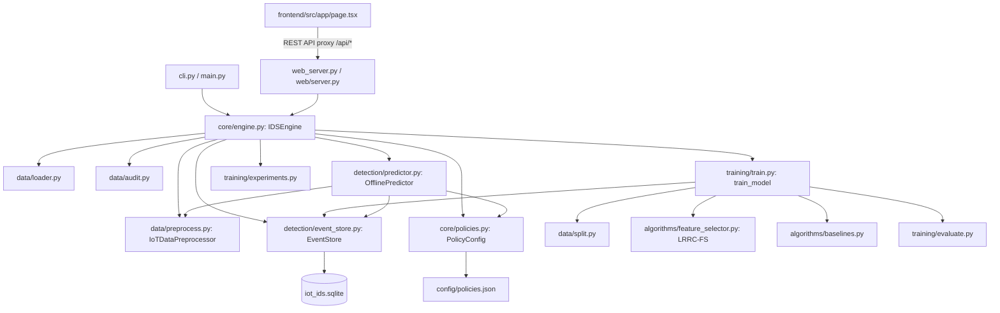

# Project Architecture & System Design Document

**System Title:** DEVRAKSHAK // AI-Based Intrusion and DDoS Detection System for IoT Networks
**Dataset Standard:** University of New Brunswick (UNB) CICIoT2023 Official Dataset Schema
**Current Date:** November 2026
**Status:** Phase 1 Complete (System Discovery & Architecture Mapping)

---

## 1. System Overview & Executive Summary

DEVRAKSHAK is an offline, reproducible, cyber-defense platform designed specifically to detect network anomalies, Distributed Denial of Service (DDoS) flood attacks, Mirai botnet activity, port reconnaissance, and web attacks targeting Internet of Things (IoT) network gateways.

The project employs a dual-tier modular architecture:

1. **Python AI & Data Processing Core:** A robust, memory-conscious machine learning engine implementing data ingestion, target label harmonization, preprocessing pipelines, class imbalance mitigation, machine learning classification, model bundle serialization, and a lightweight REST API.
2. **Web-Based Security Operations Center (SOC) Frontend:** A dedicated web application (with both a standalone zero-dependency HTML5/JS dashboard and a modern Next.js 14 React client) communicating with the Python REST API to provide real-time telemetry, model management, interactive dataset testing, and security policy control.

---

## 2. Directory Structure

```text
D:\mini project\
├── config\                               # Static runtime configurations
│   ├── policies.json                     # Firewall & alert threshold policy definitions
│   └── settings.json                     # System parameter overrides
├── data\                                 # Data storage partitions
│   ├── processed\                        # Preprocessed feature manifests & aligned arrays
│   ├── raw\                              # Authentic CICIoT2023 dataset partitions
│   │   ├── MERGED_CSV\                   # 63 official merged dataset partitions (~9.4 GB)
│   │   │   └── MERGED_CSV\               # Merged01.csv to Merged63.csv (40 columns each)
│   │   └── README.md                     # Dataset documentation & UNB source citations
│   └── synthetic\                        # Offline deterministic synthetic test traffic
│       ├── cli_test.csv                  # Offline benchmark CSV
│       └── cli_test.meta.json            # Synthetic provenance metadata
├── docs\                                 # Technical documentation & audit artifacts
│   └── PROJECT_ARCHITECTURE.md           # [This Document]
├── frontend\                             # Next.js 14 Enterprise SOC Frontend
│   ├── src\
│   │   └── app\
│   │       ├── globals.css               # Tailwind CSS & custom SOC design tokens
│   │       ├── layout.tsx                # Master page layout & metadata
│   │       └── page.tsx                  # Single-Page Dashboard with 7 operational tabs
│   ├── next.config.mjs                   # Next.js config with API proxy rewrites to Port 8000
│   ├── package.json                      # Next.js, React 18, Tailwind CSS, Lucide dependencies
│   ├── postcss.config.mjs                # PostCSS configuration
│   ├── tailwind.config.ts                # Tailwind design theme (cyber & alert palettes)
│   ├── tsconfig.json                     # TypeScript compiler configuration
│   └── README.md                         # Frontend execution guide
├── models\                               # Serialized model bundles (.joblib)
│   ├── run_binary_decision_tree_*.joblib
│   ├── run_binary_random_forest_*.joblib
│   └── run_multiclass_random_forest_*.joblib
├── results\                              # Experimental artifacts, metrics, and plots
│   ├── metrics\                          # JSON evaluation reports per training run
│   ├── plots\                            # Confusion matrix PNG plots
│   ├── reports\                          # Markdown benchmark reports
│   └── predictions_50k.csv               # Historical batch prediction export
├── src\                                  # Python Backend & ML Source Code
│   ├── algorithms\                       # Feature selection implementations
│   │   ├── __init__.py
│   │   ├── baselines.py                  # AllFeatures, VarianceThreshold, EstablishedKBest
│   │   └── feature_selector.py           # Custom LRRC-FS Feature Selector
│   ├── core\                             # System orchestration, settings, and logging
│   │   ├── __init__.py
│   │   ├── engine.py                     # IDSEngine facade orchestrating all operations
│   │   ├── events.py                     # Pydantic v2 data models for runs and detections
│   │   ├── logging_config.py             # Rotating file & console logging handlers
│   │   ├── policies.py                   # Rule evaluation & threshold matching engine
│   │   └── settings.py                   # Pydantic BaseSettings with environment validation
│   ├── data\                             # Data loading, preprocessing, and taxonomy
│   │   ├── __init__.py
│   │   ├── audit.py                      # Dataset integrity, NaN, Inf, and schema auditor
│   │   ├── loader.py                     # Memory-conscious streaming chunk CSV loader
│   │   ├── preprocess.py                 # IoTDataPreprocessor with PreprocessingManifest
│   │   ├── split.py                      # Stratified, leakage-resistant data splitter
│   │   ├── synthetic.py                  # Realistic synthetic CICIoT2023 traffic generator
│   │   └── taxonomy.py                   # 46 canonical features & 34->8 attack category mapping
│   ├── detection\                        # Prediction engine & event storage
│   │   ├── __init__.py
│   │   ├── event_store.py                # SQLite database manager (iot_ids.sqlite)
│   │   └── predictor.py                  # OfflinePredictor for batch & streaming CSV flows
│   ├── training\                         # Model training, evaluation, and experiments
│   │   ├── __init__.py
│   │   ├── evaluate.py                   # Metrics, FPR, latency, and confusion matrix plotting
│   │   ├── experiments.py                # LRRC-FS vs Baselines & Imbalance benchmark runners
│   │   └── train.py                      # Pipeline executor & TrainedModelBundle container
│   ├── tui\                              # Legacy Textual terminal UI (preserved)
│   │   ├── screens\                      # Chat, logs, monitor, policies, runs, settings
│   │   └── app.py                        # Textual App entrypoint
│   ├── web\                              # Web server & embedded client
│   │   ├── static\                       # Embedded HTML5, CSS, JS frontend assets
│   │   ├── __init__.py
│   │   └── server.py                     # Multi-threaded HTTP server & REST API controller
│   ├── cli.py                            # CLI command parser
│   ├── main.py                           # Master application entrypoint
│   └── web_server.py                     # Dedicated web server launcher
├── tests\                                # Automated test suite (Pytest)
│   ├── test_cli.py                       # CLI command integration tests
│   ├── test_core.py                      # Settings, logging, and policy tests
│   ├── test_data.py                      # Loader, taxonomy, preprocessor, and split tests
│   ├── test_detection.py                 # Predictor and SQLite event store tests
│   ├── test_pipeline.py                  # End-to-end training and inference tests
│   ├── test_training.py                  # Model training, metrics, and bundle tests
│   ├── test_tui.py                       # Textual terminal UI tests
│   └── test_web.py                       # HTTP server and REST API tests
├── iot_ids.log                           # Rotating log file
├── iot_ids.sqlite                        # Persistent SQLite database
├── pyproject.toml / requirements.txt     # Python dependencies
├── start_fullstack.bat                   # 1-click launcher for Next.js + Python backend
└── start_web.bat                         # Unified Windows launcher
```

---

## 3. Technology Stack

| Layer                         | Technology                  | Version                          | Purpose                                                 |
| :---------------------------- | :-------------------------- | :------------------------------- | :------------------------------------------------------ |
| **Language (Backend)**  | Python                      | 3.14.0                           | Core AI/ML runtime, data processing, and REST API       |
| **Language (Frontend)** | TypeScript / JavaScript     | Node v22.19.0                    | Next.js 14 client runtime                               |
| **Data Processing**     | Pandas, NumPy               | pandas 3.1.0, numpy 2.5.4        | Chunked tabular data manipulation and array operations  |
| **Machine Learning**    | Scikit-learn, Scipy         | scikit-learn 1.9.1, scipy 1.18.1 | Classifiers, metrics, feature selectors, and scaling    |
| **Class Balancing**     | Imbalanced-learn            | imbalanced-learn 0.14.2          | Random Under-Sampling and SMOTE                         |
| **Serialization**       | Joblib                      | joblib 1.6.0                     | Compression and persistence of trained model bundles    |
| **Validation**          | Pydantic, Pydantic-Settings | pydantic 2.14.1                  | Schema validation for events, audits, and configuration |
| **Persistence**         | SQLite                      | 3.x (built-in)                   | Storage of training runs, metrics, and detection alerts |
| **Visualization**       | Matplotlib                  | matplotlib 3.11.2                | Confusion matrix rendering (headless Agg backend)       |
| **Backend Server**      | Python `http.server`      | Standard Library                 | Multi-threaded HTTP server with REST JSON API           |
| **Frontend Framework**  | Next.js (App Router), React | Next.js 14.2.15, React 18.3.1    | Responsive enterprise SOC dashboard                     |
| **Styling**             | Tailwind CSS                | tailwindcss 3.4.14               | Modern, clean UI styling                                |
| **Testing**             | Pytest                      | pytest 9.1.1                     | Unit, integration, and regression testing               |

---

## 4. End-to-End Data & Processing Flow

```
[Raw CSV Dataset] (data/raw/MERGED_CSV/Merged01.csv ... Merged63.csv)
       │
       ▼
[src/data/loader.py]
  - Discovers CSV/Zip files
  - Reads header only to inspect columns
  - Ingests records via chunk generator (chunk_size=50,000)
       │
       ▼
[src/data/split.py]
  - Splits into Train (80%) and Test (20%)
  - Stratifies on label if min class count >= 2
  - Zero test leakage guarantee (Test split is untouched)
       │
       ▼
[src/data/preprocess.py: IoTDataPreprocessor]
  - Identifies target column ('Label' or 'label')
  - Maps labels via [src/data/taxonomy.py]:
      • Binary: BENIGN vs ATTACK
      • Multiclass: 8 Canonical Categories (Benign, DDoS, DoS, Mirai, Recon, Spoofing, Web, BruteForce)
  - Cleans NaN and +/- Inf values
  - Fits SimpleImputer (median) on TRAIN partition ONLY
  - Fits StandardScaler (mean, scale) on TRAIN partition ONLY
  - Fits LabelEncoder on TRAIN partition ONLY
  - Generates PreprocessingManifest with learned statistics
  - Transforms Train & Test sets independently
       │
       ▼
[src/algorithms/feature_selector.py: LRRCSFeatureSelector]
  - Fits greedy selector on TRAIN partition ONLY
  - Computes Target Relevance: R_norm(f) via ANOVA F-statistic
  - Computes Inter-Feature Redundancy: D(f, S) via Pearson correlation
  - Computes Computational Cost: C_norm(f) based on packet parsing complexity
  - Scores: Score(f) = w_rel * R_norm - w_red * D - w_cost * C_norm
  - Selects top k features (default: 15)
  - Transforms Train & Test feature matrices
       │
       ▼
[src/training/train.py: apply_resampling] (OPTIONAL)
  - Applied exclusively to TRAIN partition
  - Strategies: None, RandomUnderSampler, SMOTE, or class_weight="balanced"
       │
       ▼
[Classifier Training]
  - Random Forest (50 trees, max_depth=12)
  - Decision Tree (max_depth=12)
  - Extra Trees (50 trees, max_depth=12)
  - HistGradientBoosting (50 iterations, max_depth=8)
       │
       ▼
[src/training/evaluate.py]
  - Evaluates on HELD-OUT TEST partition
  - Measures latency (ms/sample)
  - Calculates Accuracy, Precision, Recall, Macro F1, Weighted F1, FPR
  - Generates classification report & confusion matrix
       │
       ▼
[Artifact Persistence]
  - Serializes TrainedModelBundle into models/run_*.joblib
  - Stores metrics JSON into results/metrics/
  - Plots confusion matrix PNG into results/plots/
  - Saves run record into SQLite (iot_ids.sqlite: training_runs table)
```

---

## 5. Prediction & Offline Inference Flow

```
[Target CSV Traffic File] (e.g., Merged01.csv)
       │
       ▼
[src/detection/predictor.py: OfflinePredictor]
  - Loads TrainedModelBundle (preprocessor, selector, classifier, labels)
  - Reads N sample flows from target CSV
  - Preprocessor extracts features and aligns with training columns
      • If unknown columns: ignored
      • If missing columns: populated using learned training medians
  - Preprocessor scales features using learned training means/scales
  - Feature selector filters to the exact k selected features
  - Classifier predicts class index and class probabilities
  - Preprocessor decodes class index to human-readable label
       │
       ▼
[src/core/policies.py: PolicyConfig]
  - Evaluates predicted attack category against active rules:
      • Mirai Botnet -> Severity: CRITICAL | Action: QUARANTINE_DEVICE
      • DDoS Flood   -> Severity: HIGH     | Action: RATE_LIMIT_PORT
      • DoS Attack   -> Severity: MEDIUM   | Action: LOG_INCIDENT
      • Recon Scan   -> Severity: LOW      | Action: MONITOR_IP
       │
       ▼
[Result Aggregation & Verification]
  - If ground truth label is present in CSV:
      • Compares prediction vs ground truth
      • Flags MATCH (✅) or MISMATCH (❌)
      • Calculates overall test accuracy % on the tested sample
  - Saves DetectionEvent records into SQLite (iot_ids.sqlite)
  - Returns structured JSON payload to Frontend
```

---

## 6. REST API Architecture

The backend HTTP server (`src/web/server.py`) binds to `http://127.0.0.1:8000` and provides the following REST endpoints:

| Endpoint                 |  Method  | Input Parameters                                                                             | Output Response                                                                                | Description                                 |
| :----------------------- | :------: | :------------------------------------------------------------------------------------------- | :--------------------------------------------------------------------------------------------- | :------------------------------------------ |
| `/api/status`          | `GET` | None                                                                                         | `{ success, status, active_model, total_events, total_attacks, db_size_mb, ... }`            | System operational health and model summary |
| `/api/datasets`        | `GET` | None                                                                                         | `{ success, total_files, files: [ { name, path, size_mb, type, is_synthetic } ] }`           | Discovered official and synthetic CSV files |
| `/api/models`          | `GET` | None                                                                                         | `{ success, total_models, models: [ { name, path, size_kb, task, algorithm, is_active } ] }` | Serialized model bundles in `models/`     |
| `/api/runs`            | `GET` | `?limit=50`                                                                                | `{ success, total_runs, runs: [ TrainingRun ] }`                                             | Historical training runs from SQLite        |
| `/api/events`          | `GET` | `?limit=50&severity=...&category=...`                                                      | `{ success, total_events, events: [ DetectionEvent ] }`                                      | Recorded detection events from SQLite       |
| `/api/stats`           | `GET` | None                                                                                         | `{ success, stats: { total_events, total_attacks, by_severity, by_category } }`              | High-level telemetry statistics             |
| `/api/policies`        | `GET` | None                                                                                         | `{ success, policies: [ PolicyConfig ] }`                                                    | Active security policy rules & thresholds   |
| `/api/policies`        | `POST` | `{ policies: [...] }`                                                                      | `{ success, message, policies: [...] }`                                                      | Updates and persists security policies      |
| `/api/logs`            | `GET` | `?limit=100&severity=...`                                                                  | `{ success, total_lines, lines: [...] }`                                                     | Reads latest log lines from `iot_ids.log` |
| `/api/audit`           | `POST` | `{ path: string, max_rows: int }`                                                          | `{ success, audit: DatasetAuditResult }`                                                     | Memory-conscious audit of dataset file      |
| `/api/test`            | `POST` | `{ file_path: str, model_path?: str, sample_limit: int, record_events: bool }`             | `{ success, summary: TestSummary, records: [ TestRecord ] }`                                 | Runs offline inference on selected dataset  |
| `/api/train`           | `POST` | `{ dataset_path, task_type, model_name, feature_selector, n_features, sample_limit, ... }` | `{ success, run: TrainingRun, model_path, features_selected }`                               | Spawns model training run                   |
| `/api/models/activate` | `POST` | `{ model_path: str }`                                                                      | `{ success, active_model, task_type, labels }`                                               | Sets default model for inference            |
| `/api/synthetic`       | `POST` | `{ n_samples: int, output_name: str }`                                                     | `{ success, file_path, samples_generated }`                                                  | Generates synthetic test traffic            |

---

## 7. Database Architecture (`iot_ids.sqlite`)

The persistent SQLite database contains two structured tables managed by `src/detection/event_store.py`:

### Table: `training_runs`

Stores historical metadata, parameters, and evaluation metrics for every training execution:

- `run_id` (TEXT, PRIMARY KEY): Unique run identifier (e.g. `run_binary_random_forest_20261027_161646`)
- `timestamp` (TEXT): ISO 8601 UTC timestamp
- `dataset_name` (TEXT): Name of source CSV file
- `is_synthetic` (INTEGER): Boolean flag (0 = authentic, 1 = synthetic)
- `task_type` (TEXT): `binary` or `multiclass`
- `model_name` (TEXT): Classifier algorithm name
- `feature_selector` (TEXT): Selector method (`lrrc`, `all`, `variance`, `kbest`)
- `selected_features_count` (INTEGER): Number of selected features ($k$)
- `selected_features` (TEXT): JSON array of selected feature name strings
- `train_samples` (INTEGER): Number of training samples
- `test_samples` (INTEGER): Number of test samples
- `training_duration_seconds` (REAL): Training execution time in seconds
- `inference_latency_ms_per_sample` (REAL): Mean per-flow inference latency in milliseconds
- `accuracy` (REAL): Test set accuracy score
- `precision` (REAL): Macro-averaged precision score
- `recall` (REAL): Macro-averaged recall score
- `macro_f1` (REAL): Macro-averaged F1 score
- `weighted_f1` (REAL): Support-weighted F1 score
- `false_positive_rate` (REAL): False Positive Rate on Benign class
- `model_path` (TEXT): Relative path to serialized `.joblib` bundle
- `status` (TEXT): `SUCCESS` or `FAILED`
- `error_message` (TEXT, NULLABLE): Error stacktrace if failed
- `class_imbalance_handled` (TEXT): Resampling strategy description
- `metrics_file` (TEXT): Path to saved metrics JSON
- `confusion_matrix_plot` (TEXT): Path to saved confusion matrix PNG

### Table: `detection_events`

Stores per-flow detection alerts and operational firewall responses:

- `id` (TEXT, PRIMARY KEY): UUID string
- `timestamp` (TEXT): ISO 8601 UTC timestamp
- `source_file` (TEXT): Source CSV dataset filename
- `row_index` (INTEGER): Zero-indexed flow record number
- `predicted_label` (TEXT): Model prediction string
- `confidence` (REAL): Prediction probability $[0.0, 1.0]$
- `is_attack` (INTEGER): Boolean flag (1 = Malicious, 0 = Benign)
- `attack_category` (TEXT): High-level category (`DDoS`, `Mirai`, `DoS`, etc.)
- `severity` (TEXT): `INFO`, `LOW`, `MEDIUM`, `HIGH`, or `CRITICAL`
- `policy_triggered` (TEXT): Triggered defense rule name
- `raw_features` (TEXT, NULLABLE): JSON dictionary of sampled numerical features

---

## 8. Frontend Architecture (`frontend/`)

The modern frontend is built with **Next.js 14** (App Router) and **React 18**:

- **Proxy Configuration:** `frontend/next.config.mjs` proxies all requests from `http://localhost:3000/api/*` directly to `http://127.0.0.1:8000/api/*`, eliminating Cross-Origin Resource Sharing (CORS) complications.
- **State Management:** Single-page reactive state in `frontend/src/app/page.tsx` managing real-time telemetry polling, dataset selection, inference test results, audit modal dialogs, and model training forms.
- **Styling & Components:** Tailwind CSS utility classes with customized cybersecurity color tokens (cyber-black `#070a13`, cyber-surface `#0b1120`, cyber-card `#0f172a`, cyber-border `#1e293b`) and Lucide React icons.
- **Zero External CDN Dependencies:** All components, icons, and styling are bundled locally, ensuring offline functionality.

---

## 9. Component Dependencies



---

## 10. Actual Entry Points & Commands (Windows)

### Primary Web Approach:

1. **1-Click Full-Stack Launcher (Recommended):**

   ```cmd
   start_fullstack.bat
   ```

   *Installs frontend dependencies if needed, starts the Python AI backend on port 8000, starts Next.js on port 3000, and opens `http://localhost:3000/` in the default browser.*
2. **Standalone Web Server (Zero-Dependency Python Web Dashboard):**

   ```powershell
   .\.venv\Scripts\python.exe src/web_server.py --port 8000
   ```

   *Serves the embedded client directly at `http://localhost:8000/` without requiring Node.js.*
3. **Two-Terminal Manual Developer Execution:**

   - **Terminal 1 (Backend):**
     ```powershell
     .\.venv\Scripts\python.exe src/web_server.py --port 8000
     ```
   - **Terminal 2 (Frontend):**
     ```powershell
     cd frontend
     npm install
     npm run dev
     ```

     *Then open `http://localhost:3000/`.*

### Testing Entry Point:

```powershell
uv run pytest --ignore=tests/test_tui.py
```

*Executes all unit, integration, and web API tests.*
